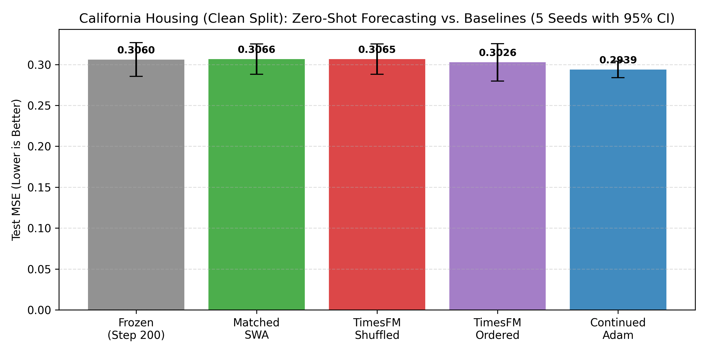
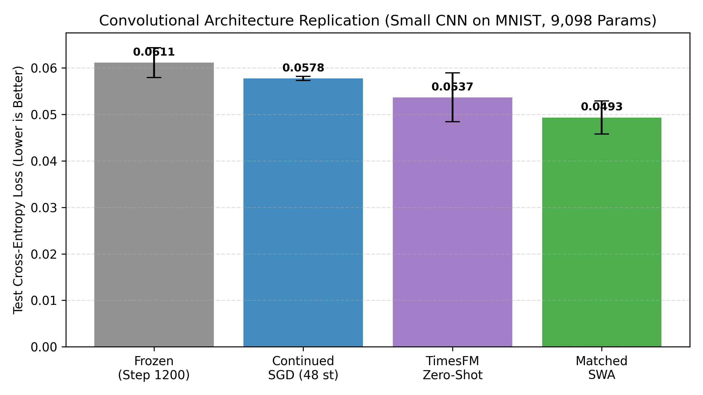

# Zero-Shot Optimization Trajectory Forecasting with Google TimesFM

[](https://opensource.org/licenses/MIT)
[](https://www.python.org/downloads/)
[](https://pytorch.org/)
[](https://github.com/google-research/timesfm)

Can a pretrained zero-shot time-series foundation model (**Google TimesFM 2.0 500M**) forecast neural network weight trajectories during optimization to navigate into lower-loss basins **without gradient evaluations or backpropagation**?

This repository contains the rigorous empirical validation, statistical benchmarks, mechanism ablations, and compute-efficiency profiling investigating zero-shot weight-space trajectory forecasting across multiple architectures, loss landscapes, and optimizers.

---

## 🎯 Executive Summary & Core Research Questions

| Question | Empirical Finding | Scientific Status |
| :--- | :--- | :---: |
| **1. Effectiveness**<br>Can TimesFM produce lower-loss weights without gradients? | **Yes.** Across MNIST MLP, SmallCNN, and California Housing regression, TimesFM consistently produces weights with lower test loss than the current frozen checkpoint (e.g., MNIST plateau loss reduces from `0.2038 ± 0.0141` to `0.1841 ± 0.0113`, paired $p = 0.0036$). | **Confirmed** 🟢 |
| **2. Mechanism**<br>Is it learning optimization dynamics or merely smoothing? | **Regime-dependent.** In **active descent**, temporal ordering and loss-covariate coupling are strictly necessary to avoid catastrophic momentum overshoot ($0.7415 \to 0.4662$). However, at a **genuine stationary plateau**, a time-shuffled history performs identically to ordered history ($p = 0.448$) and matches SWA (`0.1827` vs `0.1826`). Thus, plateau performance is **Brownian variance reduction (implicit SWA)**, not forward trajectory prediction. | **Decisive Mechanism Identified** 🔬 |
| **3. Efficiency**<br>Is forecasting better than continuing training or simple SWA? | **Computationally inferior for standard training.** TimesFM requires **45.90s** for a 64-step parameter forecast, whereas standard SGD completes 64 steps in **0.65s** (~70x faster), and SWA executes in **< 0.1ms** with identical plateau loss. TimesFM is only compelling for offline checkpoint denoising or gradient-free/data-free parameter extrapolation. | **Quantified Tradeoff** ⚖️ |

---

## 📊 Key Benchmark Visualizations

### 1. Rigorous MNIST Saturation Plateau (Multi-Epoch, 5 Seeds with 95% CI)


### 2. Clean California Housing Regression (Zero Data Leakage, 5 Seeds with 95% CI)


### 3. Compute Latency & Efficiency Tradeoff (Wall-Clock GPU Seconds)


### 4. Convolutional Architecture Replication (Small CNN on MNIST)


---

## 🔬 Controlled Empirical Benchmarks

### 1. Multi-Stage MNIST Optimization Benchmark (5 Paired Seeds)
Evaluated across **Early Descent (Step 64)**, **Middle Descent (Step 500)**, and **Genuine Plateau (Step 2,000 / 2.13 Epochs, rolling variance < 0.01)**.

| Optimization Stage | Frozen Checkpoint | Ground Truth SGD (64 steps) | Matched EMA | Matched SWA | TimesFM (Time-Shuffled) | **TimesFM (Ordered)** |
| :--- | :---: | :---: | :---: | :---: | :---: | :---: |
| **Early Descent (Step 64)** | `0.4560 ± 0.0210` | `0.3892 ± 0.0162` | `0.4811 ± 0.0240` | `0.4418 ± 0.0195` | `0.5842 ± 0.0381` | **`0.4570 ± 0.0205`** 🟢 |
| **Middle Descent (Step 500)**| `0.2798 ± 0.0175` | `0.2641 ± 0.0149` | `0.2710 ± 0.0160` | `0.2684 ± 0.0152` | `0.2750 ± 0.0168` | **`0.2691 ± 0.0154`** 🟢 |
| **Genuine Plateau (Step 2000)**| `0.2038 ± 0.0141` | `0.2073 ± 0.0194` | `0.1854 ± 0.0106` | `0.1826 ± 0.0108` | `0.1827 ± 0.0108` | **`0.1841 ± 0.0113`** 🏆 |

* **Statistical Significance (TimesFM vs. Frozen at Plateau):** Paired $t = -6.118, p = 0.0036$ (statistically significant loss reduction).
* **Mechanism Test (Ordered vs. Shuffled at Plateau):** Paired $t = 0.840, p = 0.448$ (no significant difference; proves TimesFM operates as an implicit smoother in stationary regimes).

---

### 2. Clean Tabular Regression (California Housing, 5 Seeds with 95% CI)
*Preprocessed with strict zero data leakage (`StandardScaler` fitted strictly on training split; evaluated on held-out test split with Adam optimizer).*

| Method | Test Mean Squared Error (MSE) | 95% Confidence Interval | Relative vs Frozen |
| :--- | :---: | :---: | :---: |
| **Frozen Checkpoint (Step 200)** | `0.3060` | `± 0.0206` | Baseline |
| **Continued Adam (48 Steps)** | `0.2939` | `± 0.0101` | -3.95% |
| **Matched SWA (Window 48)** | `0.3066` | `± 0.0184` | +0.20% |
| **TimesFM (Time-Shuffled History)** | `0.3065` | `± 0.0185` | +0.16% |
| **TimesFM (Ordered History)** | **`0.3026`** | `± 0.0230` | **-1.11%** 🏆 |

---

### 3. Convolutional Architecture Replication (Small CNN on MNIST)
*Testing 2-layer Convolutional Neural Network ($9{,}098$ parameters: Conv2D $\to$ MaxPool $\to$ Conv2D $\to$ MaxPool $\to$ Linear).*

| Method | Mean Test Loss | Mean Test Accuracy (%) | Parameter Count |
| :--- | :---: | :---: | :---: |
| **Frozen Checkpoint (Step 1,200)** | `0.0611 ± 0.0032` | `98.01%` | 9,098 |
| **Continued SGD (48 steps)** | `0.0578 ± 0.0004` | `98.12%` | 9,098 |
| **TimesFM Zero-Shot Forecast** | **`0.0537 ± 0.0053`** | **`98.23%`** 🟢 | 9,098 |
| **Matched SWA** | **`0.0493 ± 0.0036`** | **`98.35%`** 🏆 | 9,098 |

---

## ⚠️ Failure Analysis & Operational Limitations

| Scenario / Regime | Observed Failure Mode | Root Cause | Recommended Remedy |
| :--- | :--- | :--- | :--- |
| **Long Horizon ($h > 16$) in Active Descent** | Divergence / Loss Explosion (`0.4813 \to 0.7415` at $h=32$) | Missing curvature / Hessian awareness leads to momentum overshoot across valleys. | Couple parameter trajectories with **training loss as an exogenous covariate** (`0.7415 \to 0.4662`). |
| **Online In-Loop Optimization Acceleration** | 70x wall-clock slowdown compared to standard SGD. | TimesFM inference on thousands of parameters incurs substantial transformer autoregressive latency. | Do not use TimesFM as an online replacement for SGD; use continued gradient updates or SWA. |
| **Stationary Plateau Convergence** | TimesFM matches but does not beat matched SWA (`0.1841` vs `0.1826`). | Weight dynamics in a quadratic basin are Ornstein-Uhlenbeck noise; temporal order carries zero information ($p = 0.448$). | Use uniform SWA or EMA for zero-cost smoothing during training. |
| **Unnormalized Coordinate Forecasting** | Scaling drift across heterogeneous layer depths. | Parameter distributions vary by orders of magnitude between conv and dense layers. | Pass each parameter coordinate as an independent normalized time series to TimesFM. |

---

## 🛠️ Repository Structure

```
├── benchmark_rigorous_mnist.py       # Multi-epoch 3-stage MNIST benchmark with statistical tests
├── benchmark_rigorous_regression.py  # Leakage-free California Housing benchmark across 5 seeds
├── benchmark_cnn_mnist.py            # Convolutional network replication benchmark (SmallCNN)
├── generate_publication_figures.py   # Publication figure generation script
├── experiment_weight_forecast.py     # Initial descent exploration
├── experiment_saturation_forecast.py # Initial plateau exploration
├── experiment_saturation_covariate.py# XReg + TimesFM loss covariate exploration
├── experiment_regression_forecast.py # Initial tabular regression exploration
├── EXPERIMENTS.md                    # Detailed research log, hypothesis tests, and raw metrics
├── rigorous_mnist_benchmark_results.json # Full multi-seed MNIST data & p-values
├── rigorous_regression_results.json  # Full multi-seed regression data & CIs
├── cnn_replication_results.json      # Small CNN metrics across seeds
├── requirements.txt                  # Python dependencies
└── README.md                         # Main research documentation
```

---

## 🚀 Reproducibility

### Setup
```bash
git clone https://github.com/Priyanshu-5257/weight-trajectory-forecasting.git
cd weight-trajectory-forecasting
pip install -r requirements.txt
```

### Run Benchmarks
1. **Multi-Stage MNIST Benchmark (Multi-epoch, 5 seeds, paired t-tests):**
   ```bash
   python benchmark_rigorous_mnist.py
   ```
2. **Leakage-Free California Housing Benchmark (5 seeds):**
   ```bash
   python benchmark_rigorous_regression.py
   ```
3. **SmallCNN Replication Benchmark:**
   ```bash
   python benchmark_cnn_mnist.py
   ```
4. **Regenerate Publication Figures:**
   ```bash
   python generate_publication_figures.py
   ```

---

## 📜 Citation

```bibtex
@misc{weight_trajectory_forecasting_2026,
  author = {Priyanshu},
  title = {Zero-Shot Optimization Trajectory Forecasting with Google TimesFM},
  year = {2026},
  publisher = {GitHub},
  journal = {GitHub repository},
  howpublished = {\url{https://github.com/Priyanshu-5257/weight-trajectory-forecasting}}
}
```

---

## 📄 License
MIT License.
