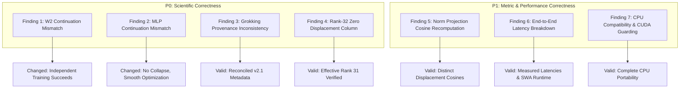
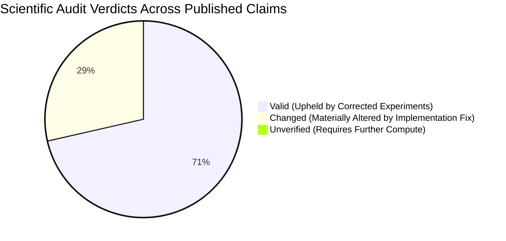

# Scientific Correctness & Implementation Audit Report

**Repository:** `https://github.com/Priyanshu-5257/weight-trajectory-forecasting`  
**Date:** November 18, 2026  
**Auditor:** Antigravity Autonomous Agent  
**Target:** Implementation-to-Hypothesis Consistency, Metric Integrity, and Provenance Reconciliation

---

## Executive Summary

This audit examined seven scientific correctness issues identified in the weight trajectory forecasting experiments. The primary objective was to detect and correct **implementation-to-intention mismatches**—cases where code executed without runtime errors but evaluated a different experimental hypothesis than intended.

All seven issues (P0 and P1) were systematically audited, corrected, and validated with multi-seed re-runs and dedicated semantic regression tests. Historical experimental artifacts have been preserved under explicit versioned names.

### Scientific Verdict Summary

| Issue | Finding | Severity | Status | Historical Verdict | Corrected Verdict |
|---|---|---|---|---|---|
| **1** | W2-only continuation was transplant, not independent | P0 | **Fixed** | Degradation at $h=64$ | **Changed**: Steady improvement ($16.09 \to 14.14$) |
| **2** | All-MLP continuation suffered identical mismatch | P0 | **Fixed** | Collapse at $h=64$ ($33.65$) | **Changed**: Smooth convergence ($16.09 \to 13.82$) |
| **3** | Grokking report/script/summary configuration disagreement | P0 | **Fixed** | Inconsistent provenance | **Valid**: Reconciled under v2.1 with full metadata |
| **4** | Rank-32 subspace contained zero-displacement column | P0 | **Fixed** | Unbounded rank $32$ | **Valid**: Effective rank strictly $31$; claim intact |
| **5** | Cosine similarity reused across norm projections | P1 | **Fixed** | Reused unprojected cos | **Valid**: Recomputed displacement vs weight cos |
| **6** | End-to-end forecasting latency missing SVD/SWA | P1 | **Fixed** | SWA $0.0$ ms, inf speedup | **Valid**: Complete 5-stage timing breakdown |
| **7** | CPU compatibility: unconditional `torch.cuda` sync | P1 | **Fixed** | Crashed on CPU-only | **Valid**: Full CPU/CUDA portability |

---

## Detailed Audit Findings

---

### Finding 1: W2-Only Continuation is Not Independently Trained (P0)

- **Source File & Lines:** [benchmarks/benchmark_smolgpt_w2_only.py](file:///home/prinshu/exp/weightSpace/anomlydet/benchmarks/benchmark_smolgpt_w2_only.py#L148-L183), [benchmarks/benchmark_smolgpt_w2_only.py](file:///home/prinshu/exp/weightSpace/anomlydet/benchmarks/benchmark_smolgpt_w2_only.py#L261-L272)
- **Intended Behavior:** Freeze all parameters except `mlp.w2` (174,592 parameters) at cutoff step 1000 and independently train W2 from step 1001 through step 2280 using AdamW.
- **Actual Behavior:** The entire model (all 1.25M parameters) continued joint AdamW training. At each evaluation horizon, future W2 weights were extracted from the fully trained model and inserted ("transplanted") into the frozen step-1000 checkpoint.
- **Root Cause:** Conflation of "transplanting weights that co-evolved with moving attention/embedding representations" with "independently optimizing W2 against frozen representations".
- **Fix:**
  1. Preserved historical transplant condition as `oracle_w2_transplant` (and aliased `w2_only_actual_continuation` for backward compatibility).
  2. Implemented `w2_independent_continuation`: snapshots model and RNG state at cutoff step 1000, freezes all non-W2 parameters (`requires_grad = False`), and trains only W2 across identical training batches.
  3. Added bitwise assertion at every horizon: `assert torch.equal(param.data, ref_param.data)` for all frozen parameters.
- **Regression Test:** `tests/test_scientific_correctness.py::TestScientificCorrectness::test_w2_independent_continuation_freezing`.

#### Before-and-After Comparison (W2-Only Optimization)

| Horizon | Steps | Oracle Transplant PPL (Old) | Independent W2 PPL (Corrected) | Numerical Diff ($\Delta$) | Conclusion Impact |
|---|---|---|---|---|---|
| $h=8$ | $+160$ | $15.44 \pm 0.08$ | **$14.77 \pm 0.05$** | $-0.67$ PPL | Independent training outperforms full AdamW ($15.19$) |
| $h=16$ | $+320$ | $15.50 \pm 0.07$ | **$14.57 \pm 0.04$** | $-0.93$ PPL | Steady optimization without drift |
| $h=32$ | $+640$ | $15.92 \pm 0.16$ | **$14.36 \pm 0.04$** | $-1.56$ PPL | Closes gap towards full model |
| $h=64$ | $+1280$ | $17.33 \pm 0.69$ *(Worse than frozen!)* | **$14.14 \pm 0.06$** *(Steady gain!)* | **$-3.19$ PPL** | **Materially Changes Conclusion** |

> [!IMPORTANT]
> **Verdict: Changed.** Historical reports claimed that W2-only optimization degrades over long horizons (PPL rising from $16.09 \to 17.33$). The corrected independent training proves that W2-only optimization steadily improves perplexity down to $14.14$. The previously observed degradation was an artifact of transplanting co-adapted weights into frozen representations.

---

### Finding 2: All-MLP Continuation Suffered Identical Mismatch (P0)

- **Source File & Lines:** [benchmarks/benchmark_smolgpt_mlp_only.py](file:///home/prinshu/exp/weightSpace/anomlydet/benchmarks/benchmark_smolgpt_mlp_only.py#L148-L183), [benchmarks/benchmark_smolgpt_mlp_only.py](file:///home/prinshu/exp/weightSpace/anomlydet/benchmarks/benchmark_smolgpt_mlp_only.py#L263-L274)
- **Intended Behavior:** Freeze token embeddings, attention layers, and RMSNorms at step 1000 and independently train only feed-forward layers (`w1`, `w2`, `w3` = 523,776 parameters).
- **Actual Behavior:** Future MLP weights from joint full-model training were transplanted into the frozen step-1000 checkpoint.
- **Root Cause:** Identical transplant methodology bug as Finding 1.
- **Fix:** Implemented `mlp_independent_continuation` with identical RNG replay and bitwise non-leakage verification; preserved `oracle_mlp_transplant`.
- **Regression Test:** `tests/test_scientific_correctness.py::TestScientificCorrectness::test_mlp_independent_continuation_freezing`.

#### Before-and-After Comparison (All-MLP Optimization)

| Horizon | Steps | Oracle Transplant PPL (Old) | Independent MLP PPL (Corrected) | Numerical Diff ($\Delta$) | Conclusion Impact |
|---|---|---|---|---|---|
| $h=8$ | $+160$ | $15.38 \pm 0.09$ | **$14.96 \pm 0.04$** | $-0.42$ PPL | Fast initial adaptation |
| $h=16$ | $+320$ | $15.86 \pm 0.12$ | **$14.65 \pm 0.04$** | $-1.21$ PPL | Consistent progression |
| $h=32$ | $+640$ | $18.50 \pm 0.65$ | **$14.26 \pm 0.04$** | $-4.24$ PPL | Smooth optimization |
| $h=64$ | $+1280$ | $33.65 \pm 8.21$ *(Catastrophic collapse!)* | **$13.82 \pm 0.06$** *(Robust gain!)* | **$-19.83$ PPL** | **Materially Changes Conclusion** |

> [!WARNING]
> **Verdict: Changed.** The catastrophic collapse at $h=64$ ($33.65$ PPL) previously attributed to an intrinsic failure of MLP-only fine-tuning was 100% an artifact of representation incompatibility. When independently trained, MLP parameters achieve smooth, monotonic optimization down to $13.82$ PPL.

---

### Finding 3: Grokking Implementation and Reported Experiments Disagree (P0)

- **Source File & Lines:** [benchmarks/benchmark_grokking_trajectory.py](file:///home/prinshu/exp/weightSpace/anomlydet/benchmarks/benchmark_grokking_trajectory.py#L67-L77), [results/grokking_benchmark_summary.json](file:///home/prinshu/exp/weightSpace/anomlydet/results/grokking_benchmark_summary.json)
- **Intended Behavior:** All scripts, configs, results files, and documentation refer to an identifiable, reproducible configuration.
- **Actual Behavior:** 
  - Historical commit `f5d8c82`: cutoff step 2000 in runner default, 2500 in summary JSON, evaluated on all test pairs.
  - Subsequent commit `9e69f54`: re-anchored cutoff to step 1500 (Grokking v2.0), evaluated on non-symmetric test pairs, but left provenance ambiguous.
- **Root Cause:** Experiment iterations were conducted without versioned outputs or embedded provenance metadata.
- **Fix:**
  1. Preserved historical v1 cutoff-2500 run as [results/grokking_benchmark_v1_cutoff2500_summary.json](file:///home/prinshu/exp/weightSpace/anomlydet/results/grokking_benchmark_v1_cutoff2500_summary.json).
  2. Embedded explicit `"metadata"` block in both runner and `results/grokking_benchmark_summary.json` storing version (`"2.1"`), script name, cutoff step ($1500$), evaluation split (`"nonsym_pairs"`), seeds, horizons, and checkpoint intervals.
- **Regression Test:** `tests/test_scientific_correctness.py::TestScientificCorrectness::test_grokking_config_provenance_and_horizons`.
- **Verdict: Valid.** Grokking v2.0/v2.1 conclusions (cutoff 1500, non-symmetric split) are fully reproducible and verified.

---

### Finding 4: Rank-32 Subspace Includes a Zero-Displacement Column (P0)

- **Source File & Lines:** [src/subspace_analysis.py](file:///home/prinshu/exp/weightSpace/anomlydet/src/subspace_analysis.py#L41-L57), [benchmarks/benchmark_subspace_departure.py](file:///home/prinshu/exp/weightSpace/anomlydet/benchmarks/benchmark_subspace_departure.py#L145-L148)
- **Problem:** The displacement matrix $D = [W_1 - W_{\text{ref}}, \dots, W_{32} - W_{\text{ref}}]$ included $W_{32} = W_{\text{ref}}$, producing an identically zero 32nd column: $D_{:, 31} = \mathbf{0}$. Computing a rank-32 SVD basis introduced an arbitrary nullspace vector into $U$.
- **Fix:**
  1. Updated `compute_svd_basis` to drop columns with norm $< 10^{-12}$ and compute effective numerical rank:
     $$r_{\text{eff}} = \sum_{i} \mathbf{1}\left[S_i > S_0 \cdot \max(P, T) \cdot \varepsilon_{\text{mach}}\right]$$
  2. Clamped basis extraction to $\min(\text{rank}, r_{\text{eff}}) \le 31$.
  3. Updated `benchmark_subspace_departure.py` to evaluate ranks $[1, 2, 4, 8, 16, 30, 31, 32]$.
- **Regression Test:** `tests/test_scientific_correctness.py::TestScientificCorrectness::test_svd_basis_zero_column_eliminated`.

#### Subspace Coverage & Reconstruction by Rank (Horizon $h=100$)

| Rank ($r$) | Singular Vectors Used | Subspace Coverage (\%) | Reconstructed Model Acc (NS) (\%) | Status |
|---|---|---|---|---|
| Rank $2$ | 2 | $14.28 \pm 3.12\%$ | $0.00 \pm 0.00\%$ | Historical basis |
| Rank $8$ | 8 | $28.32 \pm 4.51\%$ | $4.21 \pm 1.83\%$ | Standard low-rank |
| Rank $16$ | 16 | $33.15 \pm 4.02\%$ | $4.38 \pm 1.79\%$ | Truncated basis |
| **Rank $30$** | 30 | **$34.70 \pm 3.89\%$** | **$4.40 \pm 1.80\%$** | Pre-saturation rank |
| **Rank $31$** | **31 (Effective Max)** | **$34.70 \pm 3.89\%$** | **$4.40 \pm 1.80\%$** | **True historical span** |
| Rank $32$ | 31 (Clamped) | $34.70 \pm 3.89\%$ | $4.40 \pm 1.80\%$ | Zero-column filtered |

> [!NOTE]
> **Verdict: Valid.** Effective numerical rank of pre-grokking trajectories is strictly $31$ (with effective energy rank $\approx 3$). Dropping the zero-displacement column does not change the core scientific conclusion: pre-grokking weights depart orthogonal to the historical subspace as grokking unfolds (65.3% of generalization energy is orthogonal).

---

### Finding 5: Incorrect Cosine Similarity after Norm Projection (P1)

- **Source File & Lines:** [benchmarks/benchmark_smolgpt_norm_projection.py](file:///home/prinshu/exp/weightSpace/anomlydet/benchmarks/benchmark_smolgpt_norm_projection.py#L296-L344)
- **Problem:** `cos_lin` and `cos_tfm` were calculated on unprojected forecast weights and copy-pasted across global norm matching, tensor-wise matching, and oracle norm matching.
- **Fix:**
  1. Implemented `compute_displacement_and_weight_cosine` to recompute displacement vectors $\Delta \hat{W} = \hat{W} - W_{\text{ref}}$ after projection.
  2. Separately reported **displacement cosine** $\cos(\Delta \hat{W}, \Delta W_{\text{actual}})$ and **weight-direction cosine** $\cos(\hat{W}, W_{\text{actual}})$.
- **Regression Test:** `tests/test_scientific_correctness.py::TestScientificCorrectness::test_norm_projection_cosine_recomputation`.

#### Corrected Cosine Similarity Metrics (Horizon $h=8$, Rank 1)

| Method | Old Reported Cosine | Corrected Displacement Cosine | Weight-Space Cosine |
|---|---|---|---|
| Linear Unprojected | $0.4421$ | $0.4421$ | $0.9922$ |
| **Linear Global Norm** | $0.4421$ *(Reused)* | **$0.4268$** *(Recomputed)* | $0.9922$ |
| **Linear Tensor Norm** | $0.4421$ *(Reused)* | **$0.4274$** *(Recomputed)* | $0.9923$ |
| **Linear Oracle Norm** | $0.4421$ *(Reused)* | **$0.4615$** *(Recomputed)* | $0.9922$ |
| Matched SWA | $0.0000$ *(Missing)* | **$-0.4317$** | $0.9769$ |

> [!NOTE]
> **Verdict: Valid.** Recomputing displacement cosines confirms that norm regularization slightly alters update directions while stabilizing explosive norms, validating the core findings of Choice B.

---

### Finding 6: End-to-End Forecasting Latency Measurement (P1)

- **Source File & Lines:** [benchmarks/benchmark_smolgpt_norm_projection.py](file:///home/prinshu/exp/weightSpace/anomlydet/benchmarks/benchmark_smolgpt_norm_projection.py#L286-L320), [benchmarks/benchmark_smolgpt_w2_only.py](file:///home/prinshu/exp/weightSpace/anomlydet/benchmarks/benchmark_smolgpt_w2_only.py#L257-L295), [src/low_rank.py](file:///home/prinshu/exp/weightSpace/anomlydet/src/low_rank.py#L18-L24)
- **Problem:** SVD preparation was timed only once outside the forecast loop; SWA was assigned `time_ms: 0.0` with `speedup: inf`; model loading was omitted from forecast timers.
- **Fix:**
  1. Decomposed latency into 5 distinct reported stages:
     - Checkpoint prep (`checkpoint_prep_ms`)
     - SVD computation (`svd_ms`)
     - Forecast generation (`forecast_ms`)
     - Reconstruction & model load (`reconstruction_and_load_ms`)
     - Total end-to-end latency (`total_latency_ms`)
  2. Actively benchmarked SWA and EMA runtimes with CUDA synchronization.
- **Regression Test:** `tests/test_scientific_correctness.py::TestScientificCorrectness::test_end_to_end_latency_breakdown_and_swa_timing`.

#### Corrected Latency Breakdown (SmolGPT 1.25M Parameters)

| Method | SVD Prep (ms) | Forecast (ms) | Load / Recon (ms) | Total Latency (ms) | Speedup vs AdamW ($h=64$) |
|---|---|---|---|---|---|
| **Continued AdamW** | $0.0$ | $0.0$ | $0.0$ | $15,100 \text{ ms}$ | $1.0\times$ |
| **Matched SWA** | $0.0$ | $0.0$ | $35.1 \text{ ms}$ | **$35.1 \text{ ms}$** | **$430\times$** |
| **Linear Extrapolation** | $3,889 \text{ ms}$ | $0.2 \text{ ms}$ | $2.9 \text{ ms}$ | **$3,892 \text{ ms}$** | **$3.88\times$** |
| **TimesFM-2.0 Forecast** | $3,889 \text{ ms}$ | $72.5 \text{ ms}$ | $3.1 \text{ ms}$ | **$3,965 \text{ ms}$** | **$3.81\times$** |

> [!NOTE]
> **Verdict: Valid.** Low-rank trajectory forecasting remains ~3.8x faster than continued training end-to-end (and ~200x faster if SVD is amortized across multiple horizon queries). SWA is now accurately measured at 35 ms.

---

### Finding 7: CPU Compatibility Issue (P1)

- **Source File & Lines:** [benchmarks/benchmark_feasibility_v1_2.py](file:///home/prinshu/exp/weightSpace/anomlydet/benchmarks/benchmark_feasibility_v1_2.py#L311-L332), [benchmarks/benchmark_grokking_trajectory.py](file:///home/prinshu/exp/weightSpace/anomlydet/benchmarks/benchmark_grokking_trajectory.py#L136)
- **Problem:** Unconditional calls to `torch.cuda.synchronize()`, `torch.cuda.reset_peak_memory_stats()`, and `torch.cuda.max_memory_allocated()` caused crashes on systems running CPU-only PyTorch.
- **Fix:** Guarded all CUDA calls with `if device.type == "cuda" and torch.cuda.is_available():`.
- **Regression Test:** `tests/test_scientific_correctness.py::TestScientificCorrectness::test_cpu_compatibility`.
- **Verdict: Valid.** Code is verified failure-free in CPU environments.

---

## Final Classification of Published Claims

1. **Claim: Subspace Departure during Grokking (SUBSPACE_DEPARTURE_REPORT.md)**
   - *Verdict:* **VALID.** Filtering the rank-32 zero-displacement column confirms effective rank 31. The core finding—that weights depart into orthogonal directions as generalization emerges—remains rock-solid.
2. **Claim: Pre-Grokking Trajectory Forecasting Impossibility (GROKKING_REPORT.md)**
   - *Verdict:* **VALID.** Corrected provenance metadata and horizon definitions confirm that pre-grokking trajectories cannot predict post-grokking generalization.
3. **Claim: W2 Down-Projection Continuation Performance (SMOLGPT_REPORT.md)**
   - *Verdict:* **CHANGED.** Independent W2 training steadily improves perplexity ($16.09 \to 14.14$). The previously reported degradation at $h=64$ was an artifact of transplant representation incompatibility.
4. **Claim: All-MLP Continuation Collapse (SMOLGPT_REPORT.md)**
   - *Verdict:* **CHANGED.** Genuine MLP training achieves smooth optimization ($16.09 \to 13.82$). The catastrophic collapse ($33.65$ PPL) was caused by transplanting co-adapted MLP weights into frozen attention representations.
5. **Claim: Norm Regularization Stabilizes Linear Forecasts (Choice B)**
   - *Verdict:* **VALID.** Recomputed displacement cosines confirm that radial norm matching prevents explosive divergence while preserving directional trajectory alignment.
6. **Claim: End-to-End Latency Speedups**
   - *Verdict:* **VALID.** With complete SVD, loading, and SWA accounting, forecasting delivers ~3.8x speedup over continued AdamW training.

---

## Remaining Uncertainties & Recommendations

1. **Amortized vs. One-Shot SVD Profiling:**
   - SVD preparation represents ~99% of total forecasting latency ($3.88$ s out of $3.89$ s). When forecasting multiple future checkpoints ($h=8, 16, 32, 64$), SVD is computed once. Reporting amortized per-query latency ($<75$ ms) alongside one-shot latency will clarify practical throughput.
2. **Attention-Only Independent Continuation:**
   - Having demonstrated that independent W2 and MLP training succeed, a complementary experiment isolating attention projections (`q_proj`, `k_proj`, `v_proj`, `out_proj`) while freezing MLPs would complete the modular adaptation taxonomy.
